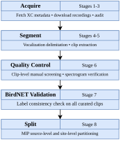

# MyGardenBird

The curation pipeline behind **MyGardenBird**, a dataset of bird vocalisations
from fifteen species common to Peninsular Malaysia — from Xeno-canto retrieval
through manual segmentation and quality control to leakage-free train/val/test
splits.

[](https://doi.org/10.5281/zenodo.20306876)

## The dataset at a glance

The dataset itself is published on Zenodo under the concept DOI
[10.5281/zenodo.20306876](https://doi.org/10.5281/zenodo.20306876), which always
resolves to the current version. This repository holds the pipeline that builds
it, not the data.

| | |
|---|---|
| Release | **v2.0** (2026-11-14) |
| Species | **15** Malaysian garden birds, **438–600** clips each |
| Clips | **8,659** manually verified 3-second segments (16 kHz); 8,287 at 44.1 kHz |
| Sample rates | 16 kHz, and a 44.1 kHz subset — not an upsampling |
| Splits | 80:10:10, 75:10:15, 70:15:15, plus a **site-grouped** 80:10:10 |
| Sources | **1,732** unique Xeno-canto recordings, each verified individually |

Class sizes are uneven because recordings licensed CC BY-NC-ND are excluded
throughout — segmentation produces a derivative work — and four species run out
of usable regional material before reaching 600.

## Validation

**BirdNET v2.4, training-free** — an independent check that the labels are what
they claim to be, not a performance benchmark. No fine-tuning; the prediction is
the top-scoring class among the fifteen.

| Sample rate | Accuracy | 95% CI | Macro AUC | *n* |
|---|---:|---:|---:|---:|
| 16 kHz | **94.83%** | 94.34–95.27 | 0.9876 | 8,659 |
| 44.1 kHz | **95.58%** | 95.12–96.01 | 0.9873 | 8,287 |

Run unrestricted over BirdNET's full 6,522-class label set, top-1 matches the
MyGardenBird label for 71.5% of clips and falls outside the fifteen for 28.1%.
**18.0% of those out-of-set predictions name a congener of the true species** —
evidence that accuracy measured on these fifteen classes is an upper bound
rather than expected field performance, since the confusable close relatives are
not in the label set. Per-clip predictions are published with the dataset so
this is checkable.

**Fine-tuned CNN benchmarks are currently out of date.** The tables in
[`benchmark_summaries/`](benchmark_summaries/README.md) were produced on the
superseded 12- and 14-species releases and are **not comparable with v2.0** —
the class count, the clip composition and the split construction all changed.
The models will be retrained on the current dataset.

## Pipeline

<p align="center">
  
</p>

<p align="center"><em>
Acquire → Segment → Quality Control → BirdNET Validation → Split
</em></p>

Stages 1–8 build the dataset and are what the data descriptor documents;
Stage 9 is a reference training script, retained for reproducibility rather
than being part of dataset construction. Lettered variants (`Stage8a`, `8b`,
`8c`) are alternative splitter implementations kept for comparison — the
released splits come from `Stage8_splitter_mip.py`. Every script derives its
paths from `pipeline/config.py`.

**Full stage-by-stage guide, hyperparameters, and reproduction commands:
[`docs/PROJECT_GUIDE.md`](docs/PROJECT_GUIDE.md).**

## Quick start

**If you just want the data**, you do not need this repository: download it from
[the Zenodo deposit](https://doi.org/10.5281/zenodo.20306876), which ships the
audio, the metadata tables and the train/val/test splits ready to use.

**To rebuild the dataset from Xeno-canto, or to train on it:**

```bash
# 1. Install. requirements.txt is grouped by stage, so you can trim it:
#    building the dataset needs no TensorFlow, training needs no GUI.
pip install -r requirements.txt

#    The annotation GUIs play audio through PortAudio, which pip does not
#    bring in:  macOS  brew install portaudio
#               Debian apt install libportaudio2

# 2. Point config at your storage, then place target_species.csv
#    in <PROJECT_ROOT>/<DATASET_NAME>/project_csv/
$EDITOR pipeline/config.py          # set PROJECT_ROOT and DATASET_NAME

# 3. Build: fetch metadata, download, annotate, extract, QC, validate, split
python pipeline/Stage1_xc_fetch_metadata.py --species all
#    ... Stages 2-7 ...
python pipeline/Stage8_splitter_mip.py --group-by-site

# 4. Or train on the released splits, without rebuilding anything
python pipeline/Stage9_train_mygardenbird_multifeature.py \
    --model efficientnetb0 --feature mel --mixup 0.2 \
    --splits_csv <deposit>/metadata16khz/splits_mip_80_10_10_sitegrouped.csv \
    --dataset_root <deposit>/mygardenbird16khz --seed 42
```

Use the **site-grouped** split for any published evaluation: it is the only one
free of site-level leakage, where recordings made by the same person at the same
place cannot be split across partitions.

## Where things live

| Topic | Location |
|---|---|
| Pipeline guide, training matrix, hyperparameters | [`docs/PROJECT_GUIDE.md`](docs/PROJECT_GUIDE.md) |
| Metadata schema / data dictionary | [`docs/DATA_DICTIONARY.md`](docs/DATA_DICTIONARY.md) |
| Pre-generated splits & QC manifests | ship with the [dataset deposit](https://doi.org/10.5281/zenodo.20306876), not this repository |
| Stage-specific notes | [`docs/STAGE4_ANNOTATOR_DOCS.md`](docs/STAGE4_ANNOTATOR_DOCS.md), [`docs/STAGE6_QC_MANIFEST_DOCS.md`](docs/STAGE6_QC_MANIFEST_DOCS.md), [`docs/STAGE8_SPLITTER_DOCS.md`](docs/STAGE8_SPLITTER_DOCS.md), [`docs/STAGE9_TRAINER_DOCS.md`](docs/STAGE9_TRAINER_DOCS.md) |
| CNN benchmark summaries | [`benchmark_summaries/`](benchmark_summaries/README.md) — **predate v2.0; retained for reference, to be retrained** |
| Helper / archived scripts | [`extras/`](extras/README.md) |

## Citing

If you use the dataset, please cite both the data descriptor and the deposit.
The deposit's concept DOI resolves to whichever version is current:

```
Zabidi, M. M. A., Idris, M. Y. I. & Idris, N.
MyGardenBird: a bird sound dataset for common Malaysian birds.
Zenodo (2026). https://doi.org/10.5281/zenodo.20306876
```

Attribution is also due to the individual Xeno-canto recordists whose
recordings the clips derive from; their names and source URLs are in
`recordings.csv`.

## Licence

**The code is [MIT](LICENSE).** Use it freely, including commercially; keep the
copyright notice.

**The dataset is CC BY-NC-SA 4.0**, reflecting the most restrictive upstream
terms among the Xeno-canto recordings it derives from. Attribution is due to the
individual recordists as well as to us — `recordings.csv` carries `recordist`
and `xc_url` for every source. Recordings licensed CC BY-NC-ND are excluded,
since segmenting one produces a derivative work the NoDerivatives term does not
permit to be distributed.

Two things the MIT licence does **not** override, spelled out in [`NOTICE`](NOTICE):

- Clips you generate with this pipeline inherit the terms of the recordings
  they came from. The ND exclusion is enforced by default and can be disabled
  (`--no-skip-nd` on Stages 2 and 2a) — if you disable it, the resulting clips
  are yours to use privately but not to redistribute.
- **BirdNET's model weights are non-commercial.** The BirdNET-Analyzer code is
  MIT, but the weights Stage 7 loads are released by the Cornell Lab of
  Ornithology under a non-commercial licence, so commercial use of Stage 7
  needs their permission. This repository neither embeds nor redistributes
  them.
