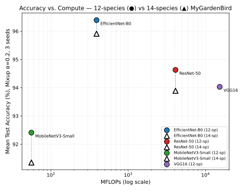

# Benchmark Summaries

> ### ⚠️ The 12-species and 14-species tables below predate dataset v2.0
>
> `16k_12species.md` and `plus_16k_14species.md` were trained on a
> **superseded** release: the 12-species core set, and the 14-species "Plus"
> set that no longer exists as a separate edition. The current release
> (**v2.0**, DOI
> [10.5281/zenodo.24217498](https://doi.org/10.5281/zenodo.24217498)) differs
> from both in ways that make those older numbers non-comparable:
>
> - **15 species**, not 12 or 14. The Common Myna, Zebra Dove and
>   Scarlet-backed Flowerpecker are now ordinary core classes.
> - **Source recordings licensed CC BY-NC-ND were removed throughout**, which
>   changed the composition of every class rather than only the class count.
> - **Class sizes are no longer uniform** — they range from 438 to 600, so
>   accuracy is no longer measured on a balanced problem.
> - **The splits are genuinely source- and site-disjoint.** The site-grouped
>   splits used here grouped by source recording only, through a defect since
>   fixed, so earlier numbers carry site-level leakage that the current ones
>   do not.
>
> **[`v2_16khz_15species.md`](v2_16khz_15species.md) has the first v2.0
> results** (single seed per model so far, not yet the full 3-seed ×
> 3-augmentation sweep below). Expect those numbers to sit *lower* than the
> 12/14-species tables on the leakage-free splits; that is a correction, not
> a regression.

Pretrained-CNN benchmarks for the MyGardenBird 16 kHz datasets. Each summary
covers 3 seeds (42, 100, 786) × 3 augmentation strategies (No Augmentation,
SpecAugment, Mixup α=0.2) on ImageNet-pretrained backbones fine-tuned on mel
spectrograms, except `v2_16khz_15species.md` (single seed so far).

| Summary | Dataset | Species | Models | Experiments |
|---|---|---|---|---|
| [`v2_16khz_15species.md`](v2_16khz_15species.md) | MyGardenBird v2.0 | 15 | EfficientNet-B0, ResNet-50, MobileNetV3-Small, MynaNet v1 | 4/4 (seed 42 only) |
| [`16k_12species.md`](16k_12species.md) | MyGardenBird (core, superseded) | 12 | EfficientNet-B0, ResNet-50, VGG16, MobileNetV3-Small | 36/36 complete |
| [`plus_16k_14species.md`](plus_16k_14species.md) | MyGardenBird-Plus (superseded) | 14 | EfficientNet-B0, ResNet-50, MobileNetV3-Small | 27/27 complete |

> VGG16 was only benchmarked on the 12-species core set; the 14-species Plus
> sweep covers the other three architectures. MynaNet v1 (a from-scratch
> deployment-focused CNN, not an ImageNet backbone) was only run on v2.0.

## Accuracy vs. Compute

Best-configuration (Mixup α=0.2) mean test accuracy vs. MFLOPs for both
datasets, log-scaled on compute:



- ● = 12-species core, ▲ = 14-species Plus (dashed line connects the same
  architecture across datasets)
- **EfficientNet-B0** dominates the accuracy/compute trade-off on both
  datasets — highest accuracy at a fraction of ResNet-50/VGG16's MFLOPs.
- Adding 2 species (12→14) costs every shared architecture ≈0.5–1.1 pp,
  with the compute-accuracy ordering unchanged.
- **VGG16** sits far to the right (15,300 MFLOPs) yet still trails
  EfficientNet-B0 and ResNet-50 in accuracy, making it the least
  compute-efficient of the four.

| Model | MFLOPs | Params | 12-sp Acc (Mixup) | 14-sp Acc (Mixup) | Δ (12→14) |
|---|---|---|---|---|---|
| EfficientNet-B0 | 390 | 4.4M | **96.39%** | **95.91%** | −0.48 pp |
| ResNet-50 | 4,100 | 24.1M | 94.63% | 93.89% | −0.74 pp |
| VGG16 | 15,300 | 14.8M | 94.03% | — (not run) | — |
| MobileNetV3-Small | 56 | 1.2M | 92.41% | 91.35% | −1.06 pp |

## v2.0 Accuracy vs. Model Size

Measured params (not literature/architecture tables) vs. test accuracy,
single seed (42), Mixup α=0.2, on the v2.0 15-species split:


| Model | Params | v2.0 Test Acc |
|---|---:|---:|
| EfficientNet-B0 | 4.38M | **92.15%** |
| MynaNet v1 (INT8) | 0.33M | 90.76% |
| ResNet-50 | 24.12M | 89.38% |
| MobileNetV3-Small | 1.24M | 88.80% |

MynaNet v1 — a from-scratch depthwise-separable CNN sized for Cortex-M7
deployment — gets within 1.4 pp of EfficientNet-B0 at 13× fewer params than
MobileNetV3-Small and 73× fewer than ResNet-50, the best accuracy-per-param
trade-off of the four. Full details and per-class breakdowns in
[`v2_16khz_15species.md`](v2_16khz_15species.md).

## Regenerating the Plots

```bash
cd benchmark_summaries
python3 accuracy_vs_mflops_figure.py       # 12-sp/14-sp MFLOPs comparison (superseded datasets)
python3 accuracy_vs_params_v2_figure.py    # v2.0 params comparison
```

The MFLOPs/accuracy figures in [`accuracy_vs_mflops_figure.py`](accuracy_vs_mflops_figure.py)
are transcribed from the tables above, which in turn come from the per-run
`results.json` files of the sweeps described below. Those run directories are
not tracked in this repository.

## Regenerating the Underlying Data

Each row in the summary tables is one run of
[`pipeline/Stage9_train_mygardenbird_multifeature.py`](../pipeline/Stage9_train_mygardenbird_multifeature.py),
which trains a single (model, augmentation, seed) configuration end-to-end and
writes `results.json` + `classification_report.txt` + `confusion_matrix.pdf`
+ `training_curves.png` to `--output_dir`. For example, to reproduce the
EfficientNet-B0 + Mixup α=0.2, seed 42, 12-species run:

```bash
python3 pipeline/Stage9_train_mygardenbird_multifeature.py \
    --model efficientnetb0 \
    --feature mel \
    --splits_csv metadata16khz/splits_mip_80_10_10.csv \
    --dataset_root /path/to/mygardenbird16khz \
    --mixup 0.2 \
    --seed 42 \
    --output_dir ./results_16k_12sp
```

`--model` accepts `mobilenetv3s`, `resnet50`, `vgg16`, `efficientnetb0`; omit
`--mixup` for the no-augmentation runs or pass `--specaug` for SpecAugment.
The full 36-run 12-species sweep (4 models × 3 augmentations × 3 seeds) is
driven by a shell loop over those cells, as is the 27-run 14-species Plus
sweep (3 models × 3 augmentations × 3 seeds) — each is one invocation of
Stage9 per (model × augmentation × seed) combination.

Note that the splits file referenced above ships with the dataset deposit
rather than with this repository; see the deposit's `metadata16khz/`.
